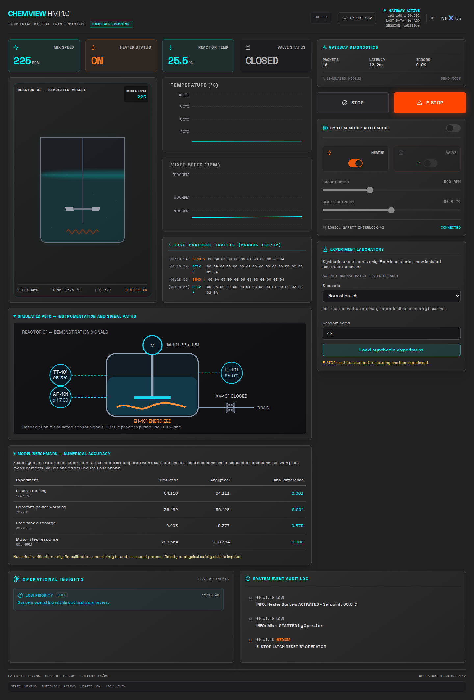
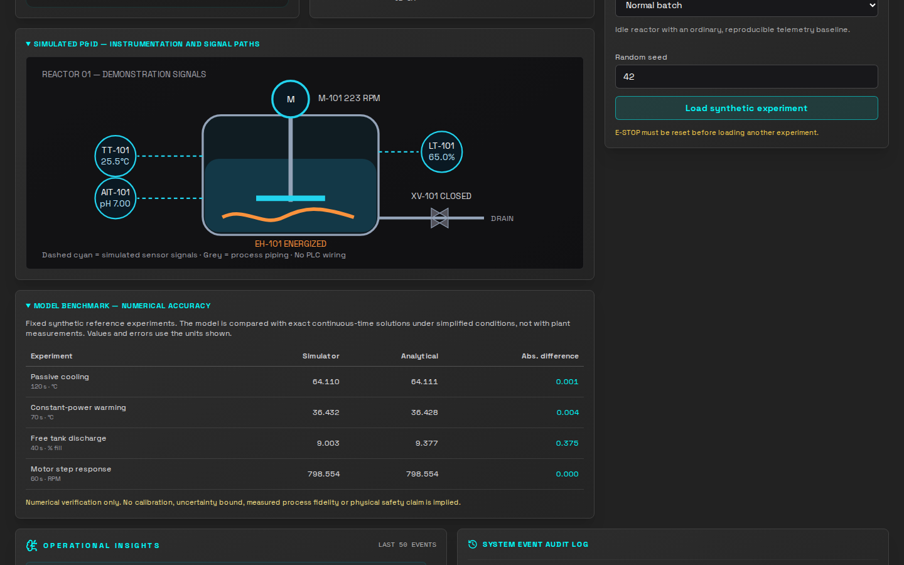

# ChemView — Chemical Mixing HMI & Synthetic Digital Twin

ChemView is a NEXUS 2.0 operator HMI for a simulated chemical mixing vessel, built to exercise industrial-automation UI patterns, safety-rule logic and numerical model validation in one Next.js app.

## Key results

- **Six seeded synthetic experiments** and a model benchmark comparing **four computed observables** against continuous-time analytical reference solutions ([scientific validation](docs/science-validation.md)).
- **One-second server-side simulation loop** with validated SSE telemetry; the UI flags data as stale after **6 seconds** without a new sample.
- Runs with no AI key, Firestore credentials, PLC or Modbus hardware.



**[Architecture](docs/architecture.md)** · **[Scientific validation](docs/science-validation.md)** · **[NEXUS 2.0 design and visual QA](docs/design-qa.md)** · **[Verification and CI](docs/integration-verification.md)** · **[Security](SECURITY.md)**

## Quick start

Requires **Node.js 22**, npm and optionally Java 21 for the Firestore emulator.

```bash
npm ci
npm run dev
```

Open `http://localhost:9002`. The simulator starts with bounded in-memory storage and deterministic alarm rules. Optional server-only credentials go in a local `.env` file; see [.env.example](.env.example). Never embed secrets in browser code.

**Quality checks**

```bash
npm run typecheck
npm run lint
npm run format:check
npm run docs:check
npm test
npm run build
npm run test:firestore  # requires Java / Firebase emulator
npm run test:e2e       # requires Playwright Chromium
```

## Features

- **Server-owned process simulation:** synthetic energy balance, tank discharge, motor response and pH observation, driven by deterministic seeded experiments.
- **Operator-focused HMI:** official NEXUS logo and midnight/cyan/blue/lavender palette, simulated P&ID, time-series plots, Modbus traffic traces, diagnostics and context-aware controls. E-STOP red and thermal-warning orange are reserved for their semantic meaning.
- **Safety-rule simulation:** mixer/discharge interlocks, minimum heater level, unconditional latched E-STOP, authenticated reset where configured and deterministic alarms.
- **Telemetry handling:** validated SSE messages, session UUIDs, duplicate/out-of-order rejection, last-known-value warnings and per-session telemetry, alarm and audit histories.
- **Optional AI explanations:** Gemini/Genkit can comment on deterministic alarms but cannot make, delay or veto interlock decisions.
- **Testing:** TypeScript, ESLint, Prettier, Vitest, Firestore emulator, Playwright and CircleCI.

## Screenshots

| Workstation width | Screenshot                                                                                        | Purpose                                          |
| ----------------- | ------------------------------------------------------------------------------------------------- | ------------------------------------------------ |
| 1366 px           | [Compact workstation](docs/assets/chemview-1366x768.png)                                          | Panel visibility and vertical scrolling          |
| 1440 px           | [Primary screenshot](docs/assets/chemview-dashboard.png)                                          | Balanced process/control workspace               |
| 1440 px           | [Focused instrumentation and numerical validation](docs/assets/chemview-engineering-evidence.png) | Both expanded engineering panels in one viewport |
| 1920 px           | [Wide workstation](docs/assets/chemview-1920x1080.png)                                            | Expanded reactor graphics and event history      |

Playwright captures of the running simulator. The workstation captures are full-page; the instrumentation image is a focused 1440×900 viewport with the P&ID and model-benchmark sections expanded. See [capture details](docs/design-qa.md).



## API

| Endpoint                               | Behavior                                                                 |
| -------------------------------------- | ------------------------------------------------------------------------ |
| `GET /api/stream`                      | Validated server-sent synthetic snapshots                                |
| `POST /api/command`                    | Server-validated operator commands; E-STOP always exempt from throttling |
| `POST /api/scenario`                   | Load a named seeded laboratory scenario; never bypasses E-STOP           |
| `GET /api/history` / `GET /api/export` | Current-run telemetry or explicitly selected archived run; CSV export    |
| `GET /api/alerts` / `GET /api/audit`   | Read-only current-run or archived synthetic event history                |

The shared simulator allows up to **60 ordinary commands per 10 seconds** and rejects stale browser preconditions when another operator changes a control. A validated SSE sample must advance before the browser marks telemetry live.

Without `OPERATOR_TOKEN`, command/scenario endpoints accept unauthenticated simulated writes; with the token set, the stock browser cannot submit protected commands. Do not expose an unrestricted write-enabled instance to the internet. See [SECURITY.md](SECURITY.md).

## Repository structure

```text
src/
  app/                         Next.js pages, REST/SSE routes and API tests
  components/
    chemical-mixing/           NEXUS 2.0 HMI and engineering instrumentation
    ui/                        Shared accessible UI components
  hooks/                       Telemetry and operator-control synchronization
  lib/                         Data validation, scientific benchmarks, utilities
  server/
    sim/                       Synthetic physics, interlocks, Modbus, scenarios
  ai/                          Optional, non-authoritative Gemini commentary
e2e/                           Playwright operator and visual regression tests
docs/
  architecture.md              Runtime architecture, interfaces and invariants
  science-validation.md        Equations and scientific limits
  design-qa.md                 NEXUS identity, image sources and UI validation
  integration-verification.md  Acceptance criteria and CI
  assets/                      Four SHA-256-pinned HMI screenshots
public/                         Official NEXUS logo
scripts/                        Documentation/image-integrity automation
.github/                        CI and opt-in Copilot engineering tools
.circleci/                       Independent read-only quality checks
.idx/                           Optional Firebase Studio editor configuration
```

See also [CONTRIBUTING.md](CONTRIBUTING.md), [SECURITY.md](SECURITY.md) (exposure and open advisories) and [CHANGELOG.md](CHANGELOG.md).

## Limitations

- **Simulation only.** One fictional vessel with no real PLC/Modbus-TCP connection or plant integration. It is not a calibrated digital twin; scientific values are illustrative.
- **Model checks verify consistency, not accuracy.** Agreement with analytical references confirms the code implements the synthetic equations; it is not calibration against real equipment.
- **No certified safety function.** Interlocks and E-STOP are simulated, with no SIL rating; physical safety measures need independent engineering verification. Archived event records are not certified audit records.
- **Not a production deployment.** Firebase/App Hosting manifests and editor configuration are optional development infrastructure. ChemView is a noncommercial project with no customer environments or production operations.

## License

MIT — see [LICENSE](LICENSE).
