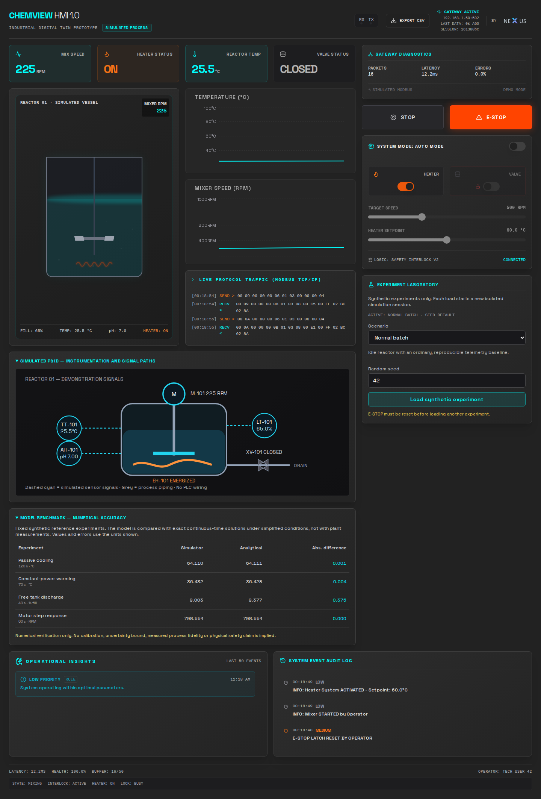

# ChemView — Industrial HMI & Mixing-Process Digital Twin

**Reviewer quick brief:** [Project scope, inspectable evidence and limitations](docs/hiring-summary.md).

[](https://github.com/senanurcetin/ChemView)

**Next.js · TypeScript · Simulated Modbus · Safety interlocks · SSE · Optional Gemini**

ChemView is an industrial HMI and digital twin **prototype** for a chemical mixing process. It demonstrates how modern web tooling can model telemetry, operator controls, communication traces, and safety interlocks in a single interface.



> The historical screenshot below will be replaced after the new responsive HMI passes screenshot QA.

**Visual identity:** ChemView is presented as an engineering demonstration _by NEXUS_, using the official transparent NEXUS logo from the user's approved brand assets. The original ChemView cyan/orange status palette is retained.

Portfolio case study: [senanur-cetin.vercel.app/projects/chemview](https://senanur-cetin.vercel.app/projects/chemview)

## What it does

- Runs the mixing-tank simulation **on the server** (physics, safety interlocks, simulated Modbus register map) and streams a snapshot to the browser every second over Server-Sent Events.
- Visualizes operator controls, trends, and the Modbus wire log in one HMI layout.
- Enforces safety interlocks server-side: the mixer cannot start with the discharge valve open, the valve cannot move while the rotor spins, and E-STOP always wins, immediately disables mixer/heater, and remains latched until an explicit reset; E-STOP is never rate limited.
- Raises deterministic rule alarms immediately, and layers optional Gemini (Genkit) commentary on top when `GEMINI_API_KEY` is set. The LLM never gates a safety decision; it is rate limited, time boxed, schema validated and falls back silently.
- Persists run-scoped telemetry, alerts and the audit trail (Firestore when configured, bounded in-memory otherwise). Read-only `/api/history`, `/api/alerts`, `/api/audit` and CSV `/api/export` support review of a single simulation run.

There is still no real PLC: the Modbus layer is a deterministic simulation, not a network client.

### Emergency-stop reset (simulator contract)

The HMI exposes **RESET E-STOP** while the simulated stop is latched. Reset clears the latch only; it never starts the mixer or enables the heater. The server rejects other commands during the latch, including setpoint and valve changes. A fresh server process initializes a new simulator state: this is **not** a hardware or persistent emergency-stop circuit.

When `OPERATOR_TOKEN` is configured, `reset_estop` is an ordinary protected operator command, while `estop` remains callable without a token. The browser HMI does not possess or store the bearer token: a reset attempted from that HMI will receive HTTP 401 in token-protected deployments. An authorized operator integration must send the token server-to-server or use an appropriately secured operator channel; do not embed the token in client JavaScript.

Offline tests cover the latch and authentication contract. This simulation is **not PLC/SIL certified**.

## Stack

- Next.js 15 (App Router, Route Handlers) and React 19
- TypeScript, Tailwind CSS, shadcn/ui, Recharts
- Genkit and Gemini for AI-assisted alert commentary
- Firebase Admin (Firestore) for optional persistence
- Vitest for unit tests, Playwright for end-to-end smoke tests

## Local setup

```bash
npm install
cp .env.example .env   # optional: GEMINI_API_KEY and FIREBASE_* values
npm run dev
```

The app runs on `http://localhost:9002`. Without any keys it works fully, using rule alarms and the in-memory store.

Quality checks (also run in CI): `npm run typecheck`, `npm run lint`, `npm run format:check`, `npm test`, `npm run build`.
Extra suites: `npm run test:firestore` (Store contract tests against the Firestore emulator, needs Java) and `npm run test:e2e` (Playwright smoke tests; set `PLAYWRIGHT_CHROMIUM_PATH` to use a preinstalled Chromium, otherwise run `npx playwright install chromium` once).

See [docs/architecture.md](docs/architecture.md) for how the pieces fit together.

## Command admission policy

The simulator models one shared process. Ordinary operator commands have a shared budget of **60 commands per 10 seconds**; client-provided proxy/IP headers cannot reset that budget. E-STOP always bypasses the limit, while E-STOP reset requires the usual authorization and quota. This protects the demo's shared command loop from simple identity rotation, but a busy client can still exhaust the ordinary-command quota for other users. It is not production-grade per-operator admission control.

## Telemetry session provenance

Each simulator process has a unique `runId`. New telemetry samples are stored by run (in memory or under Firestore `sim_runs/<runId>/telemetry`) so identical timestamps from separate process sessions cannot overwrite each other. `/api/history` and `/api/export` default to the current run; use a previously recorded UUID via `?runId=<uuid>` to inspect an archived run. CSV includes a `run_id` column. The browser waits for a valid SSE snapshot before loading history for that exact run.

Legacy untagged Firestore records in `telemetry` are **not deleted or migrated**. They remain available through the Store's unscoped history API but are excluded from the new run-scoped dashboard and HTTP defaults. This is a simulation history contract, not certified plant historian behavior.

## HMI telemetry freshness

Cross-session and malformed SSE audit/alarm events are rejected before HMI
rendering. After a simulator restart the browser ignores late packets from
previously observed run IDs, so old process data cannot override new readback.

The operator display shows the current simulator session and the age of the latest validated telemetry snapshot. If an SSE connection stays open but delivers no advancing samples for 6 seconds, the header switches to `Gateway Stale` and a visible warning labels the displayed process readings as **last known values**. A new accepted sample clears the stale status; reconnecting the transport alone does not imply current data. An engine-session change is shown explicitly. These indicators are for this simulated HMI only and must not be mistaken for field-device or safety-system health.

## Shared-process operator readback

The setpoint sliders follow server-owned values, including accepted writes from another browser. When an operator drags a manual-mode slider, the HMI displays a draft and sends one command on release; an unconfirmed setpoint is labeled `(PENDING)` until the SSE stream echoes its applied value. Denied or unconfirmed drafts revert to server readback. Normal operator controls are disabled if telemetry is stale/disconnected or E-STOP is latched, while the E-STOP action itself stays available. An operator action racing a stale connection is also rejected client-side, though server-side interlocks remain authoritative.

## Session-scoped alarm history

The simulator records its rule-based and optional AI alarm events by `runId`; `GET /api/alerts` returns the last 50 events for the current process run (or `?runId=<uuid>&limit=<1..100>` for a selected archived run). The dashboard merges archived events with live SSE events, showing up to 50 distinct entries. Memory storage keeps the most recent 200 alarm events; Firestore uses `sim_runs/<runId>/alerts`. Older top-level Firestore alerts are retained but excluded from the current-session API. These events are historical observations, not safety-rated alarm acknowledgements. Incoming telemetries with impossible physical readings are rejected before updating the HMI.

## Concurrent setpoint updates

The HMI sends a setpoint command with the expected server value captured at the beginning of a drag and the active simulator `runId`. The engine compares those optional preconditions atomically with its current in-process state. If another operator changed that setpoint, or the simulator restarted, it rejects the stale request with HTTP 409 without writing a simulated Modbus frame. Ordinary API clients can continue to omit these optional fields for backward compatibility. These checks avoid silent lost updates on the two manual setpoints; they are not general transaction isolation across every plant command.

## Concurrent switch and mode controls

Alongside RPM and temperature compare-and-set requests, the HMI now supplies the current simulator `runId` and the observed value for ordinary START/STOP, heater, valve, manual/automatic mode and E-STOP reset commands. The engine rejects stale run or state preconditions with HTTP 409 before generating a simulated Modbus write. This prevents an outdated operator screen from silently undoing a newer switch action. The simulated E-STOP never requires a matching readback. Legacy external clients may omit these optional fields and retain last-write-wins behavior.

## E-STOP event ordering

The simulator tags each E-STOP with an increasing `estopEpoch`. An HMI RESET
includes the observed epoch and is denied with HTTP 409 if a newer E-STOP
occurred before processing. E-STOP itself remains unconditional, including
during connection interruptions; older API clients that omit the optional
reset precondition remain supported.

## Delayed command responses

HTTP command replies are asynchronous and may arrive after a simulation restart,
a later operator action, or an E-STOP. The HMI discards obsolete ordinary-command
feedback so the current process display does not show an error from an earlier
session or a superseded request. E-STOP failures still surface to the operator.
The process state remains server-owned and is refreshed only through validated
SSE snapshots.

## Run-scoped operator audit trail

Audit events now carry the simulator `runId`, alongside telemetry and alerts.
The HMI merges live audit entries with up to 50 archived events for the current
run; the read-only `GET /api/audit?runId=<uuid>&limit=<1..100>` endpoint can
inspect earlier runs. Older, untagged Firestore records remain available in
the legacy Store collection, but are excluded from current-session displays.
These records are not cryptographically signed or certified audit evidence.

## AI commentary and simulation events

AI commentary is optional and supplementary to deterministic process alarms. The HMI receives
an analysis-in-progress update only when an actual Gemini request starts; idle ticks do not
generate duplicate SSE messages. Late model responses are ignored after an E-STOP, operator
control change, or change of the triggering condition. AI analysis is skipped while E-STOP is
latched. This behavior is part of the simulated HMI, not a safety-rated control mechanism.

## Scope and operational boundaries

The process, Modbus register map, interlocks, and telemetry are simulated. No physical PLC, fieldbus gateway, safety-rated controller, or plant equipment is connected. This is an engineering demonstration, **not a certified safety system**. Production use would require independent industrial safety assessment, hardened access controls and validated equipment integration.

## License

MIT
