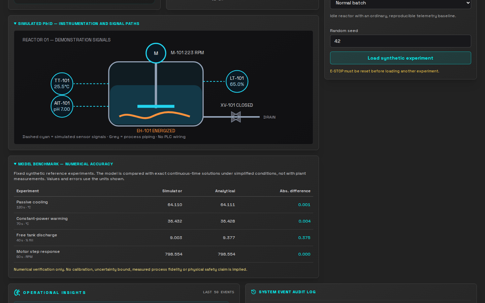

# HMI design, responsive QA and source screenshots

ChemView uses the **approved NEXUS 2.0 identity** from Google Drive → `Logo/NEXUS_Identity_2_0`, adapted to an engineering HMI rather than copying a marketing banner. The source of truth for the brand palette is that folder's identity-pack `README.md`; the implementation is `src/app/globals.css`. The checked-in `public/nexus-logo.png` is used by the actual Next.js dashboard. This remains a **synthetic process illustration**, not a connected industrial station.

## Committed screenshot gallery

Screenshots below come from the **actual running Playwright demo**, not Figma mockups, AI-rendered images or equipment photographs. The mixer and synthetic heater are enabled in the capture fixture. Crucially, both **Simulated P&ID** and **Model benchmark — numerical accuracy** expanders are opened before screenshots. Earlier committed images showed these new engineering sections collapsed; those images were valid UI captures but incomplete evidence of current functionality.

| Viewport  | Full-page capture                                                | Checked properties                                                                    |
| --------- | ---------------------------------------------------------------- | ------------------------------------------------------------------------------------- |
| 1366×768  | [Compact HMI](assets/chemview-1366x768.png)                      | NEXUS identity, control access and scrollability without horizontal document overflow |
| 1440×900  | [Default portfolio image](assets/chemview-dashboard.png)         | Expanded instrumentation and scientific verification visible with operator controls   |
| 1440×900  | [Engineering evidence](assets/chemview-engineering-evidence.png) | Dedicated checked-in capture showing current P&ID and analytical comparison table     |
| 1920×1080 | [Wide workstation](assets/chemview-1920x1080.png)                | Expanded reactor graphic and legible lower-page event/audit sections                  |

**Screenshot provenance:** The four checked-in PNGs were individually matched to the actual Chromium Playwright captures from [GitHub Actions run 39606570852](https://github.com/senanurcetin/ChemView/actions/runs/39606570852) (source commit `56ca5059e610efad414ecfb9e807d8471fd1c615`, artifact `chemview-hmi-design-captures`, ID `12347714694`). That run's Playwright job passed; later formatting corrections and the complete HMI integration passed [postmerge main CI 39608107163](https://github.com/senanurcetin/ChemView/actions/runs/39608107163). The later [maintenance main CI 39615510325](https://github.com/senanurcetin/ChemView/actions/runs/39615510325) also passed without replacing these images.

The three workstation screenshots are **full-page** (their height may exceed the viewport); the engineering-evidence image is a **focused 1440×900 viewport**. Neither Figma mockups nor synthetic image-generation outputs are used as browser verification. The reviewed image content is pinned by SHA-256 in `scripts/check-docs.mjs`.

## Approved NEXUS 2.0 theme implementation

| Token    | Approved value | ChemView responsibility                                        |
| -------- | -------------- | -------------------------------------------------------------- |
| Midnight | `#0B0F19`      | Main work surface and background                               |
| Depth    | `#061524`      | Deep process surface, controls and instrument inset            |
| Cyan     | `#00E0FF`      | Primary readbacks, active instrumentation and focus indication |
| Blue     | `#4EA8FF`      | Supporting telemetry, panel borders and secondary signals      |
| Lavender | `#8F9BFF`      | Gradient hierarchy and scientific annotation                   |
| Violet   | `#6E55C6`      | Subdued identity accents, never alarm priority                 |
| Silver   | `#B9C5CE`      | Muted labels and secondary textual readbacks                   |

The original generic gray background and `#00FFFF` cyan were replaced by a layered midnight/depth canvas and the sanctioned gradient accents. Typography still uses the NEXUS identity pack's Space Grotesk family with a readable data/monospace hierarchy. Panels use bounded blue borders, subtle top-to-bottom depth gradients and conspicuous keyboard focus. No new marketing artwork or substitute logo was generated.

**Operational color separation:** Hot-heater/thermal-warning orange and E-STOP/fault red remain distinct **semantic safety signals**; neither is rebranded violet or blue. Status is also spelled out in text. Color styling cannot guarantee real-world safety, certified interlock behavior or physical equipment control.

**Scientific and responsive presentation:** The vessel animation, P&ID identifiers (TT-101, AIT-101, LT-101, M-101, EH-101, XV-101), benchmark table and event logs preserve their existing behavior. At 1366, 1440 and 1920 px the document must not overflow horizontally; lower panes remain vertically reachable. Reduced-motion preferences disable simulated mechanical animation.

## Automated and manual acceptance

Playwright verifies the seven approved brand tokens and workspace background, an active simulation, logo visibility, essential controls, reactor size, absence of horizontal document overflow, scrollable audit history and accessible model-benchmark table. The capture matrix checks 1366, 1440 and 1920 px widths. The NEXUS logo and system labels remain legible; lower history sections are reachable by scrolling. Image layout was additionally inspected using the saved CI PNGs.

These checks do **not** establish WCAG conformance, keyboard-only usability across every control, accessibility color-contrast ratios, live PLC connections or physical safety. The diagram is illustrative, and the display does not provide a certified safety-rated emergency-stop function.

For new visual changes, regenerate captures with `npm run test:e2e`, inspect the successful CI artifact at all sizes, then update `docs/assets/`, this provenance section and the image SHA-256 fingerprints in `scripts/check-docs.mjs` together. This prevents an older or altered PNG from passing as the reviewed capture merely because its dimensions are valid. Keep disposable `artifacts/` files out of Git.
